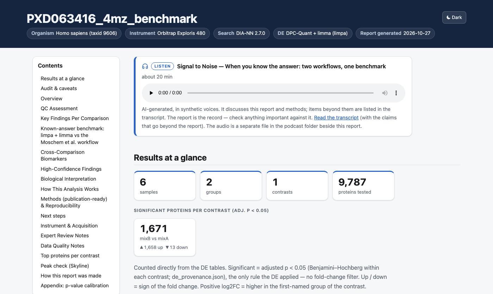

# UC Davis Proteomics AI Skill

[](https://github.com/bsphinney/UCD-Proteomics-AI-Skill)
**Using the skill and finding it useful? [Give it a star on GitHub](https://github.com/bsphinney/UCD-Proteomics-AI-Skill)** (the ☆ Star button at the top right of this page). It takes one click and helps the Core show that the skill is used.

**The UC Davis Proteomics Core pipeline, as a skill for Claude.** Give it a folder of raw mass-spec
files (`.raw`, `.d` or `.mzML`) and say in your own words what the experiment is. It works out the
acquisition type and instrument, derives the search parameters from them, and runs a pinned search
engine (DIA-NN, FragPipe or Sage, on your own computer or on a SLURM cluster). Then it does the statistics
(limpa/limma differential expression, with QC) and writes the report, the publication Methods and a
reproducibility bundle. For the Core's own projects it also delivers the results to the
collaborator. It asks only for what the data cannot tell it, such as which samples belong to which
group. It runs in Claude Code and Claude Desktop. The plugin is `ucdavis-proteomics-core-pipeline`.

**Contents:**
[See it work](#see-it-work) ·
[What you get](#what-you-get) ·
[Why you can trust it](#why-you-can-trust-it) ·
[Install](#install) ·
[Quick start](#quick-start) ·
[How it works](#how-it-works) ·
[What data it handles](#what-data-it-handles) ·
[Requirements and where it runs](#requirements-and-where-it-runs) ·
[Documentation map](#documentation-map) ·
[How each release is tested](#how-each-release-is-tested) ·
[Getting help](#getting-help-and-reporting-a-problem) ·
[Repository layout](#repository-layout) ·
[What's new](#whats-new) ·
[License and citation](#license-and-citation) ·
[DE-LIMP (previous version)](#de-limp-app-previous-version)

## See it work

[](https://www.youtube.com/watch?v=roHknILC-Ec)

*The skill searches timsTOF and Orbitrap DIA data
([watch on YouTube](https://www.youtube.com/watch?v=roHknILC-Ec)).*

[](https://bioshare.bioinformatics.ucdavis.edu/bioshare/download/3rxqjlo5rx3asty/PXD063416_4mz_analysis/output/Analysis_Report_with_audio.html)

*The top of a real report: the skill's re-analysis of the public HeLa + yeast benchmark PXD063416 (PRIDE; Moschem et al., J Proteome Res 2025), at 4 m/z isolation windows. The whole report is one self-contained HTML file. **Click the picture to open that full report**, with its podcast (an
audio overview) built in; it is about 25 MB. The [cross-window comparison](https://bioshare.bioinformatics.ucdavis.edu/bioshare/download/3rxqjlo5rx3asty/Window_Comparison_Report_with_audio.html) (2, 4, 6 and 10 m/z,
also with its podcast) is in the same public share.*

<!-- PLACEHOLDER-2.15-CLIP (TODO, Brett records it): replace this comment and the
     "(Video to follow.)" below with the 2.15 tutorial clip, a thumbnail linked to the video as
     above. -->
**New in 2.15:** ask *"show me the data for &lt;protein&gt;"* and see that protein's evidence
from your own data. *(Video to follow.)*

## What you get

- **The report.** `Analysis_Report.html` is one self-contained file with every figure embedded: QC,
  volcano plots, PCA and the top proteins. It comes with a PDF copy and a plain-text version for
  NotebookLM, and the session folder opens from `README.html`.
- **Methods for the paper.** `methods.md` and `methods.docx` are written from the instrument's own
  files, with the instrument grant acknowledgment when the samples were run at the Core. Anything
  the files do not record is marked for you to fill in.
- **A reproducibility bundle.** The analysis as plain R with every value written out, the exact tool
  versions, checksums of the inputs and a `reproduce.sh` that runs it again.
- **`AGENTS.md`.** A guide to every file in the session for the next AI assistant, or person, who
  opens it, including where the raw data, the search and the database live.
- **The podcast, if you ask for it.** *Signal to Noise* is a two-host audio discussion of your
  results, written from your report. Every number and protein name in it is checked against the
  report, and the recording is transcribed back and compared with the script. It is AI-generated,
  in synthetic voices.

## Why you can trust it

- **Pinned engines.** One version of the skill always runs the same engine versions. In this
  release (2.15.1) they are DIA-NN 2.7.0, Sage 0.14.7, FragPipe 24.0, Radiant 2.3.3 (container), and Skyline 26.1.0.266 for the peak check. It never swaps in a different version without telling you.
- **Every setting has a source.** The search parameters come from your data type and instrument,
  not from a template. Each value records where it came from (measured from your files, the
  instrument's table, or a default, marked as a default), so you can see why it chose 15 ppm.
- **6,000+ automated tests.** They run on every change to the skill, and a release also runs them
  on the Core's cluster.

## Install

You need [Claude Code](https://claude.com/claude-code). In a terminal, paste this one line:

```
claude plugin marketplace add https://github.com/bsphinney/UCD-Proteomics-AI-Skill.git && claude plugin install ucdavis-proteomics-core-pipeline@ucdavis-proteomics-core
```

Start Claude Code (or run `/reload-plugins` if it is already open) and ask: *"analyze my
proteomics data in /path/to/raw_files"*.

Or inside Claude Code: paste the first command, press Enter, then the second.

```
/plugin marketplace add https://github.com/bsphinney/UCD-Proteomics-AI-Skill.git
```

```
/plugin install ucdavis-proteomics-core-pipeline@ucdavis-proteomics-core
```

Keep it current: `/plugin` → **Marketplaces** → **ucdavis-proteomics-core** → **Enable
auto-update**. If an update says "already at the latest version" while a newer one is out, refresh
the catalogue first:

```
git -C ~/.claude/plugins/marketplaces/ucdavis-proteomics-core pull --ff-only
```

The **[install guide](https://bsphinney.github.io/UCD-Proteomics-AI-Skill/skill-install.html)** covers Claude Desktop, updates and
troubleshooting.

**Installed it before 2.15, from DE-LIMP?** Until 2.15 the skill lived in the DE-LIMP repository.
You get 2.15.1 from there as usual, and it moves your catalogue here by itself when a session
starts, and tells you. If it could not (offline, or Claude Desktop), move it yourself with one line
([install guide](https://bsphinney.github.io/UCD-Proteomics-AI-Skill/skill-install.html#moved)).

## Quick start

1. [Install](#install) the plugin (one line) and start Claude Code.
2. Ask in your own words. For example:

   > *Analyze my proteomics data in /path/to/raw_files.*

   The skill finds out what it can from the files (acquisition type, instrument), then asks what
   the files cannot tell it: the organism, which samples belong to which group, the digestion
   enzyme, and a few more (see [step 3](#how-it-works)). It then shows the settings it
   resolved, such as the engine and its version, the mass accuracy and where that number came
   from, the database and the statistics. It runs after one "go" from you.

   > *Search these Orbitrap DDA files with FragPipe, semi-specific, trypsin.*

   or

   > *Re-search this run with different settings.*

   A single search with no statistics is fine too. The skill still uses its own search script,
   not a hand-written command line.

   > *Show me the data for &lt;protein&gt;.*

   After an analysis, this builds a page with that protein's evidence from your own data.
   Facts about the protein are looked up in public sources, never written from memory
   ([where they come from](skill/ucdavis-proteomics-core-pipeline/references/protein-card-sources.md)).

   > *Write the LC-MS Methods section for these runs.*

   It writes `methods.md` and `methods.docx` from the instrument's own files. Anything the files
   do not record is marked for you to fill in.
3. Open `Analysis_Report.html` in the session folder. `README.html` there lists everything else.

## How it works

Every analysis follows the same steps, with or without statistics. Claude reads
[`SKILL.md`](skill/ucdavis-proteomics-core-pipeline/SKILL.md), which says what to do at each step
and which reference file holds the detail (the step numbers below are SKILL.md's). The scripts are in
[`scripts/`](skill/ucdavis-proteomics-core-pipeline/scripts/).

| Step | What happens | Detail |
|---|---|---|
| 0. Is the skill current? Is this computer set up? | Checks the skill version and installs the tools it needs on first use (no admin rights). Asks where the heavy work will run. | [install](skill/ucdavis-proteomics-core-pipeline/references/install.md), [access](skill/ucdavis-proteomics-core-pipeline/references/access.md), [environment](skill/ucdavis-proteomics-core-pipeline/references/environment.md) |
| 1. Find the raw files | You give a folder or a list of `.d`, `.raw` or `.mzML` files. | [access](skill/ucdavis-proteomics-core-pipeline/references/access.md) |
| 2. Detect acquisition and instrument | Reads the files to tell DIA from DDA, the instrument, and the scan range. If it is not sure, it asks you. | [search-engines](skill/ucdavis-proteomics-core-pipeline/references/search-engines.md) |
| 3. Ask the study questions | Organism, database type, contaminants, experiment type, digestion enzyme (full, semi or no specificity), sample type, and which sample is in which group. It asks; it never guesses these from file names. | [study-questions](skill/ucdavis-proteomics-core-pipeline/references/study-questions.md), [conditions](skill/ucdavis-proteomics-core-pipeline/references/conditions.md) |
| 4. Resolve the parameters and confirm once | Settings come from your data type and instrument. Each value records its source. You confirm once. | [parameters](skill/ucdavis-proteomics-core-pipeline/references/parameters.md) |
| 5–6. Get the pinned engine, build the database | Installs the engine version this release pins. Downloads the proteome for your organism and adds contaminants. | [search-engines](skill/ucdavis-proteomics-core-pipeline/references/search-engines.md), [environment](skill/ucdavis-proteomics-core-pipeline/references/environment.md) |
| 7. Search, and watch the search | Runs the engine (on a cluster, as SLURM jobs) and watches it to the end. It fixes a failed or stalled job itself. | [search-engines](skill/ucdavis-proteomics-core-pipeline/references/search-engines.md), [DIA-NN chain](skill/ucdavis-proteomics-core-pipeline/references/diann_parallel.md), [FragPipe DIA](skill/ucdavis-proteomics-core-pipeline/references/fragpipe-diatracer.md), [watcher](skill/ucdavis-proteomics-core-pipeline/references/watcher.md) |
| 8. Differential expression | limpa (DPC-Quant) with limma by default. The skill checks whether to use normalised quantities and asks you to decide when the check is not clear. Optional protein-set tests. Significance is the adjusted P value alone. | [de-analysis](skill/ucdavis-proteomics-core-pipeline/references/de-analysis.md), [set-tests](skill/ucdavis-proteomics-core-pipeline/references/set-tests.md) |
| 8c–8f. Check the results | Automatic checks for common mistakes. Every warning is shown to you, and a failed check stops the interpretation until it is resolved. A peak check with Skyline runs by default where it can run. | [audit](skill/ucdavis-proteomics-core-pipeline/references/audit.md), [anomaly-checks](skill/ucdavis-proteomics-core-pipeline/references/anomaly-checks.md), [skyline](skill/ucdavis-proteomics-core-pipeline/references/skyline.md) |
| 9. Report | Claude reads the tables and figures and writes `Analysis_Report.html`. Every number comes from the result tables. | [analysis](skill/ucdavis-proteomics-core-pipeline/references/analysis.md) |
| 9d. Methods | `methods.md` and `methods.docx`, with no guessed values. | [methods](skill/ucdavis-proteomics-core-pipeline/references/methods.md) |
| 10–11. Reproducibility bundle | The analysis as plain R, the exact tool versions, input checksums and a `reproduce.sh`. | [reproducibility](skill/ucdavis-proteomics-core-pipeline/references/reproducibility.md) |
| 12. Finalize | Writes `AGENTS.md` and `README.html`, lists every file, and packs the session. | [outputs](skill/ucdavis-proteomics-core-pipeline/references/outputs.md), [deposit](skill/ucdavis-proteomics-core-pipeline/references/deposit.md) |
| 12b. Deliver (Core submissions) | Staff only: results go to the collaborator through Bioshare, after a second, separate yes. | [core-submissions](skill/ucdavis-proteomics-core-pipeline/references/core-submissions.md) |

The skill's own rules for itself are at the top of `SKILL.md`. The main ones: it confirms before
it spends compute; it never invents a parameter; it never runs heavy work on a login node; it
shows every warning; and the choices that belong to people (which run is which sample, which
runs to leave out, normalised or raw quantities) are asked, never decided by Claude.

## What data it handles

The route is picked from the acquisition type and the instrument by one table in the skill
([`engine_choice.py`](skill/ucdavis-proteomics-core-pipeline/scripts/engine_choice.py);
[search-engines.md, "Routing"](skill/ucdavis-proteomics-core-pipeline/references/search-engines.md)).
You can always ask for a different engine; the skill honours it or says why it cannot.

| Your data | Engine | Notes |
|---|---|---|
| DIA (Thermo or Bruker) | **DIA-NN**, the default | Also offered: FragPipe DIA (Thermo, or Bruker dia-PASEF with diaTracer; not on a Mac), and Radiant + Fulcrum (Thermo Orbitrap only; its licence is stated before fee-for-service work). For commercial use, where DIA-NN's academic licence does not apply, AlphaDIA is the alternative the skill lists. More than 5 DIA-NN files on a cluster run as a 5-step SLURM chain. |
| timsTOF DDA-PASEF | **FragPipe** | If FragPipe cannot run where the search runs, Sage runs instead and the record says it was the fallback and why. |
| Orbitrap DDA with no enzyme rule (non-specific, pepsin) | **FragPipe** (non-specific workflow) | Same fallback to Sage. |
| Other DDA (for example a tryptic Orbitrap digest) | **Sage** | FragPipe on request. |
| SILAC | DIA-NN plexDIA, with ratios inside each run | [silac.md](skill/ucdavis-proteomics-core-pipeline/references/silac.md) |
| Unknown organism or no proteome | De novo (Casanovo), then DIAMOND against nr and a lowest-common-ancestor call | [denovo.md](skill/ucdavis-proteomics-core-pipeline/references/denovo.md) |
| No groups to compare (an ID list, QC, one sample per condition, a benchmark) | Same search routes; the statistics are skipped | [no-de-route.md](skill/ucdavis-proteomics-core-pipeline/references/no-de-route.md) |

Input is `.raw` (Thermo), `.d` (Bruker) or `.mzML`. An instrument the skill does not recognise is
never a stop: it falls back to automatic mass calibration and says so. A Thermo Stellar
(unit-resolution) is searched for identifications only. Statistics use limpa DPC-Quant with limma
for DIA-NN results. For FragPipe results it uses limma on IonQuant's intensities (one experiment), directLFQ
(two), or IonQuant's MaxLFQ (three or more); for Sage, on Sage's own peptide-level quantities, which are not MaxLFQ.
The Methods name the quantity that was used ([de-analysis.md](skill/ucdavis-proteomics-core-pipeline/references/de-analysis.md)).

## Requirements and where it runs

- **Claude.** [Claude Code](https://claude.com/claude-code) (terminal or VS Code) or Claude
  Desktop. The [install guide](https://bsphinney.github.io/UCD-Proteomics-AI-Skill/skill-install.html) covers both.
- **Your computer.** macOS, Linux, or Windows (WSL2 is the recommended route; native Windows with
  Git Bash also works, because the engines ship Windows builds). The details and the limits per
  system are in [install.md](skill/ucdavis-proteomics-core-pipeline/references/install.md).
- **What it installs for you, with no admin rights.** On first use, `setup.sh` puts one
  self-contained environment in `~/.proteomics-pipeline/` (Python, R, limpa, limma, Sage,
  ThermoRawFileParser and the rest). Deleting that folder uninstalls it. Nothing is installed
  system-wide.
- **The one manual step.** DIA-NN has no Mac build, so on a Mac, DIA data needs Docker Desktop
  (free). The skill tells you when, and what to click.
- **Engines that cannot run everywhere.** FragPipe has no macOS build, so on a Mac, timsTOF DDA
  goes to Sage, and DIA to DIA-NN in Docker (slow on Apple Silicon, where DIA-NN is emulated) or Radiant (Thermo Orbitrap only).
- **A laptop or a cluster.** Either the skill installs everything on your own computer, or it
  runs the heavy steps as SLURM jobs on a cluster, driven over SSH from your computer, and
  watches them. Claude Code stays on your computer, not on the cluster. It asks you which at the
  start.
- **UC Davis HIVE.** If you have a HIVE account and an SSH key, the skill can run everything
  there. [access.md](skill/ucdavis-proteomics-core-pipeline/references/access.md) is the runbook.
  On UC Davis clusters the HPC@UCD `ucd-hpc` skill takes priority on cluster policy.
- **Internet** for the first setup, the engines and the protein databases.

## Documentation map

Everything the skill reads lives in
[`skill/ucdavis-proteomics-core-pipeline/`](skill/ucdavis-proteomics-core-pipeline/). The
reference files are in
[`references/`](skill/ucdavis-proteomics-core-pipeline/references/).

**Start here**

| Document | What it is |
|---|---|
| [SKILL.md](skill/ucdavis-proteomics-core-pipeline/SKILL.md) | The skill's instructions: the rules and the steps, each pointing to a reference. |
| [Install guide](https://bsphinney.github.io/UCD-Proteomics-AI-Skill/skill-install.html) | Claude Code, Claude Desktop, updates and troubleshooting. |
| [How these reports are made](docs/how-reports-are-made.html) | Which parts established software does, which parts Claude writes, and how your lab can run the same. |
| [What's in the skill](docs/SKILL_INVENTORY.md) | Every script, reference and data file, what it does and what uses it. Generated from each file's own header by `tools/make_inventory.py`; a check fails when it is out of date. |
| [CHANGELOG](CHANGELOG.md) | What changed in every release. |
| [Student setup](docs/STUDENT_SETUP.md) | An install walkthrough for students, written to be read by a student or handed to Claude. |

**Searching**

| Reference | What it covers |
|---|---|
| [search-engines.md](skill/ucdavis-proteomics-core-pipeline/references/search-engines.md) | Detecting the data type, engine routes, licensing, program sources, running a search, Sage and FragPipe details. |
| [parameters.md](skill/ucdavis-proteomics-core-pipeline/references/parameters.md) | How each search parameter is derived from the data type, with its source. |
| [study-questions.md](skill/ucdavis-proteomics-core-pipeline/references/study-questions.md) | What the skill asks before the search, and what each answer changes. |
| [conditions.md](skill/ucdavis-proteomics-core-pipeline/references/conditions.md) | Telling the skill which sample is in which group. |
| [diann_parallel.md](skill/ucdavis-proteomics-core-pipeline/references/diann_parallel.md) | The 5-step SLURM chain for DIA-NN. |
| [fragpipe-diatracer.md](skill/ucdavis-proteomics-core-pipeline/references/fragpipe-diatracer.md) | FragPipe with diaTracer for dia-PASEF. |
| [silac.md](skill/ucdavis-proteomics-core-pipeline/references/silac.md) | SILAC with DIA-NN plexDIA. |
| [denovo.md](skill/ucdavis-proteomics-core-pipeline/references/denovo.md) | Species identification by de novo sequencing and homology. |
| [no-de-route.md](skill/ucdavis-proteomics-core-pipeline/references/no-de-route.md) | An analysis with no differential expression. |
| [cross-tool-comparison.md](skill/ucdavis-proteomics-core-pipeline/references/cross-tool-comparison.md) | Comparing two search engines fairly. |
| [environment.md](skill/ucdavis-proteomics-core-pipeline/references/environment.md) | How the skill adapts to where it runs; the database and the R stack. |

**Statistics and checks**

| Reference | What it covers |
|---|---|
| [de-analysis.md](skill/ucdavis-proteomics-core-pipeline/references/de-analysis.md) | Differential expression: methods, design, covariates, the normalisation check, figures. |
| [set-tests.md](skill/ucdavis-proteomics-core-pipeline/references/set-tests.md) | Protein-set tests. |
| [audit.md](skill/ucdavis-proteomics-core-pipeline/references/audit.md) | The automatic checks for common mistakes. |
| [anomaly-checks.md](skill/ucdavis-proteomics-core-pipeline/references/anomaly-checks.md) | How unusual results are judged, and the expert review. |
| [skyline.md](skill/ucdavis-proteomics-core-pipeline/references/skyline.md) | The Skyline peak check. |

**Reports, Methods and the protein screen**

| Reference | What it covers |
|---|---|
| [analysis.md](skill/ucdavis-proteomics-core-pipeline/references/analysis.md) | How the report is written. |
| [methods.md](skill/ucdavis-proteomics-core-pipeline/references/methods.md) | The Methods section and the instrument acknowledgment. |
| [protein-screen.md](skill/ucdavis-proteomics-core-pipeline/references/protein-screen.md) | "Show me the data for a protein". Design: [docs/specs/protein-data-screen-design.md](docs/specs/protein-data-screen-design.md). |
| [protein-card-sources.md](skill/ucdavis-proteomics-core-pipeline/references/protein-card-sources.md) | Where each protein fact on that page comes from. |
| [podcast.md](skill/ucdavis-proteomics-core-pipeline/references/podcast.md) | The *Signal to Noise* audio discussion, and its consent rules. |
| [outputs.md](skill/ucdavis-proteomics-core-pipeline/references/outputs.md) | The session folder, re-analysis, and finalize. |
| [deposit.md](skill/ucdavis-proteomics-core-pipeline/references/deposit.md) | Files for depositing the data in PRIDE or MassIVE. |

**Reproducibility**

| Reference | What it covers |
|---|---|
| [reproducibility.md](skill/ucdavis-proteomics-core-pipeline/references/reproducibility.md) | The two levels of reproducibility and the bundle. |

**Clusters and running searches**

| Reference | What it covers |
|---|---|
| [access.md](skill/ucdavis-proteomics-core-pipeline/references/access.md) | Where the skill runs, SSH to HIVE, keeping the skill current. |
| [watcher.md](skill/ucdavis-proteomics-core-pipeline/references/watcher.md) | Watching a search, fixing failures, and resuming. |
| [install.md](skill/ucdavis-proteomics-core-pipeline/references/install.md) | What `setup.sh` installs and the manual steps per system. |

**For UC Davis Proteomics Core staff** (everyone else never meets these)

| Reference | What it covers |
|---|---|
| [core-submissions.md](skill/ucdavis-proteomics-core-pipeline/references/core-submissions.md) | A CoreOmics submission, from "search submission 807" to a shared Bioshare folder. |
| [ht-submissions.md](skill/ucdavis-proteomics-core-pipeline/references/ht-submissions.md) | Searching a whole high-throughput plate. |
| [board.md](skill/ucdavis-proteomics-core-pipeline/references/board.md) | The Core project board. |
| [qc-bracket.md](skill/ucdavis-proteomics-core-pipeline/references/qc-bracket.md) | QC runs around a project. |
| [fran.md](skill/ucdavis-proteomics-core-pipeline/references/fran.md) | Handing each Core search to FRAN, the Core's cross-search corpus. |
| [notifications.md](skill/ucdavis-proteomics-core-pipeline/references/notifications.md), [run-registry.md](skill/ucdavis-proteomics-core-pipeline/references/run-registry.md), [notes.md](skill/ucdavis-proteomics-core-pipeline/references/notes.md), [slack-collab.md](skill/ucdavis-proteomics-core-pipeline/references/slack-collab.md) | Job-end notices, the run registry, notes from the Core, and Claudes working together in Slack. |

## How each release is tested

- **The unit tests.** The skill has 6,000+ automated tests, in
  [`skill/ucdavis-proteomics-core-pipeline/tests/`](skill/ucdavis-proteomics-core-pipeline/tests/).
  GitHub runs them with the other checks (script syntax, scripts named in the docs exist, the
  plugin and marketplace versions agree, the README's links resolve, the file inventory is
  current) on every push and pull request
  ([`skill-checks.yml`](.github/workflows/skill-checks.yml)). Before a release the Core also runs
  the full suite on its HIVE cluster. Tests that need private lists of client and staff names skip
  on GitHub, and run only on the Core's own computer.
- **A before-and-after comparison on real data.** Before 2.15.0 was released, fresh Claude
  sessions ran the same request on the previous release (2.14.2) and on 2.15, on seven real
  datasets (public and Core DIA and DDA, from 2 to 300 runs), and the results were compared. The
  table, what matched, what did not, and what was fixed are in the CHANGELOG under
  [How it was checked](CHANGELOG.md#how-it-was-checked).

## Getting help and reporting a problem

- **A problem during an analysis.** The skill records each of its own problems as it happens,
  with `report_issue.sh`, and tells you in one line. For Core members the record goes to the
  Core's shared folder. For anyone else it is kept in `~/.proteomics-pipeline/issues/` and the
  skill prints how to send it ([skill-issues.md](skill/ucdavis-proteomics-core-pipeline/references/skill-issues.md)).
  Problems with your data (a failed injection, a bad run) are not recorded there; they go in the
  report.
- **Questions, bugs and requests.** Open an issue at
  [https://github.com/bsphinney/UCD-Proteomics-AI-Skill/issues](https://github.com/bsphinney/UCD-Proteomics-AI-Skill/issues). Paste the exact error text. Do not paste data you
  may not share.
- **Earlier audit.** An audit of defects found in the skill (August 2026) is in
  [docs/SKILL_OPEN_DEFECTS.md](docs/SKILL_OPEN_DEFECTS.md). Check the CHANGELOG for what has been
  fixed since.
- **If the skill helped you.** A [star on GitHub](https://github.com/bsphinney/UCD-Proteomics-AI-Skill) helps the Core show that the
  skill is used.

## Repository layout

| Folder | What is in it |
|---|---|
| [`skill/ucdavis-proteomics-core-pipeline/`](skill/ucdavis-proteomics-core-pipeline/) | The skill itself: `SKILL.md`, `references/`, `scripts/`, `presets/` (FragPipe and Radiant workflows), `hooks/`, and `tests/`. This is what gets installed. |
| [`docs/`](docs/) | The web pages (the install guide, "How these reports are made"), the file inventory, setup notes, and method write-ups such as the de novo FDR validation. Published as GitHub Pages. |
| [`tools/`](tools/) | `make_inventory.py`, which writes `docs/SKILL_INVENTORY.md`, and its tests. |
| [`contaminants/`](contaminants/) | The contaminant sequence files the skill adds to a database, with [`provenance.json`](contaminants/provenance.json). |
| [`.claude-plugin/`](.claude-plugin/) | The plugin catalogue (`marketplace.json`) that Claude Code reads when you add this repository. |
| [`.github/workflows/`](.github/workflows/) | The checks GitHub runs on every change. |

## What's new

This is version **2.15.1** (2026-11-19). What changed in it and in every earlier release is in the
[CHANGELOG](CHANGELOG.md).

## License and citation

Free for noncommercial use (academic, non-profit and government research, and teaching) under the
[PolyForm Noncommercial License 1.0.0](LICENSE). Commercial use needs a separate licence: contact
Brett Phinney, UC Davis Proteomics Core (bsphinney@ucdavis.edu). The search engines the skill
downloads come with licences of their own.

If you use it in published work, cite it as [CITATION.cff](CITATION.cff) describes (GitHub's
**Cite this repository** button gives APA and BibTeX), and cite the tools your Methods name.

## DE-LIMP app (previous version)

Before this skill, the Core's pipeline was **DE-LIMP**, an R Shiny app with a point-and-click
interface for DIA-NN results. It is kept as it is and gets no new features. You can still
[try it on Hugging Face](https://huggingface.co/spaces/brettsp/de-limp-proteomics). Its code and
documentation are at [github.com/bsphinney/DE-LIMP](https://github.com/bsphinney/DE-LIMP).
